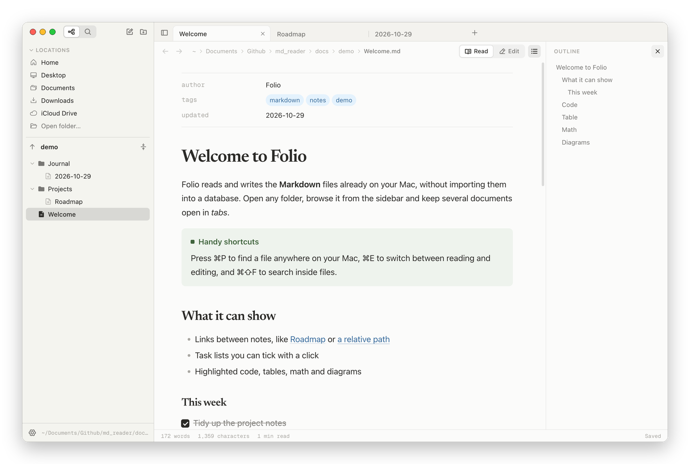
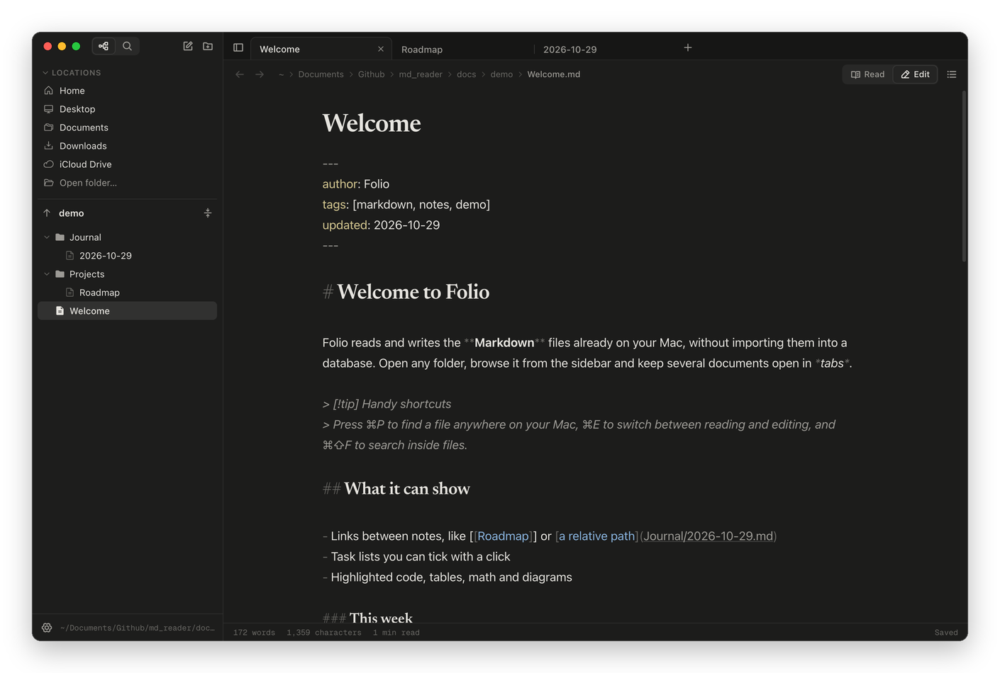
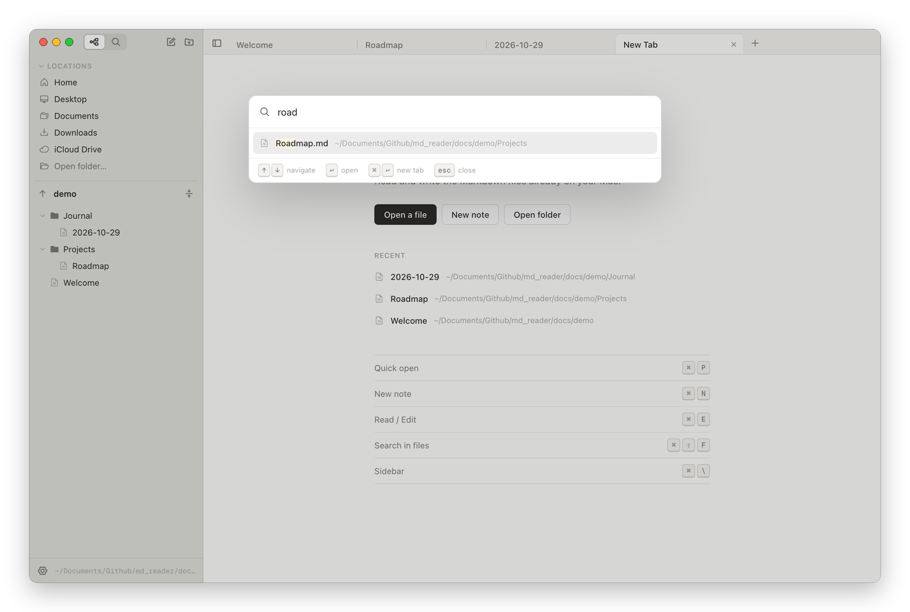

<p align="center">
  
</p>

<h1 align="center">Folio</h1>

<p align="center">
  A Markdown reader and editor for macOS, with a folder tree and tabs.
</p>



Folio opens the Markdown files you already have on your Mac, wherever they live. There is no vault to import and no database: you browse folders from the sidebar, open several documents in tabs, read them nicely formatted and edit them with autosave. Think of Obsidian, cut down to reading and writing files.

## Features

**Navigation**
- Sidebar with quick locations (Home, Desktop, Documents, Downloads, iCloud Drive), favorite folders and an arrow to climb all the way up to the root of the disk
- A tree that shows only folders and Markdown files and updates when you change things in Finder
- Rename, move by dragging, create notes and folders, move to Trash
- Reorderable tabs, back/forward history per tab, session restored on relaunch

**Reading and writing**
- Read mode and edit mode (⌘E), with the same typography and the scroll position kept
- Autosave; files changed by other apps are reloaded
- Outline of headings and find in document

**Formatting**
- Highlighted code with a copy button, tables, footnotes
- Math with KaTeX (`$…$` and `$$…$$`) and Mermaid diagrams
- Task lists you can tick directly in read mode
- Obsidian-style callouts (`> [!tip]`), `[[note]]` links, local images
- YAML front matter shown as a properties table
- `.textbundle` packages

**Search**
- ⌘P finds any Markdown file on your Mac by name, through Spotlight
- ⌘⇧F searches the contents of the files in the open folder

**Appearance**
- Light, dark or system theme; serif or sans reading font; adjustable text size and page width

| Editing, dark theme | Quick open |
| --- | --- |
|  |  |

## Installation

Download `Folio-<version>-arm64.zip` from the [Releases](https://github.com/cesarebed/folio/releases) page, unzip it and drag `Folio.app` into Applications.

The app is not signed with an Apple Developer certificate, so macOS blocks it the first time you open it. To unblock it, run this in Terminal:

```sh
xattr -dr com.apple.quarantine /Applications/Folio.app
```

The published build is for Apple Silicon Macs. On an Intel Mac, build from source.

## Shortcuts

| Action | Keys |
| --- | --- |
| Quick open | ⌘P |
| New note / new tab | ⌘N / ⌘T |
| Read ↔ Edit | ⌘E |
| Find in document / in files | ⌘F / ⌘⇧F |
| Close tab / reopen closed tab | ⌘W / ⌘⇧T |
| Next / previous tab | ⌃Tab / ⌃⇧Tab |
| Go to tab 1–9 | ⌘1 … ⌘9 |
| Back / Forward | ⌘[ / ⌘] |
| Sidebar / Outline | ⌘\ / ⌘⇧\ |
| Bold, italic, link (while editing) | ⌘B, ⌘I, ⌘K |
| Larger / smaller text | ⌘= / ⌘- |

⌘-click a file or a link to open it in a new tab.

## Development

Requires Node.js 22 or later.

```sh
npm install
npx electron-vite dev   # run in development
npm run typecheck       # type check
npm run dist            # build release/mac-arm64/Folio.app with an ad-hoc signature
```

The `docs/demo` folder has a few sample notes to open with Folio.

**Layout**
- `src/main` — Electron main process: file system, Spotlight, watchers, menu
- `src/preload` — IPC bridge to the UI
- `src/renderer` — React UI: tree, tabs, reader (markdown-it) and editor (CodeMirror 6)

## License

[MIT](LICENSE)
