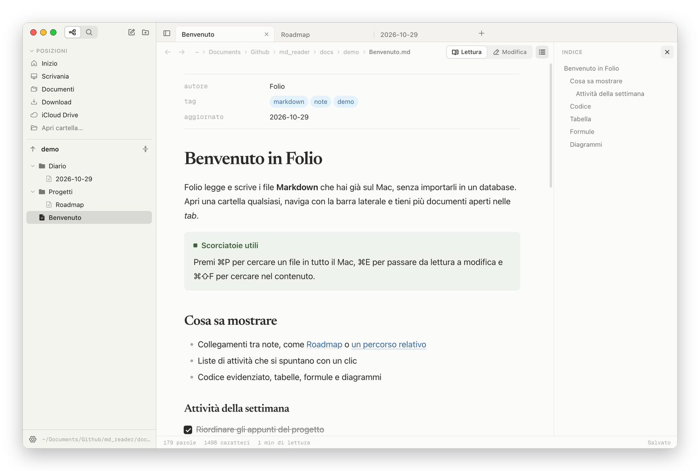
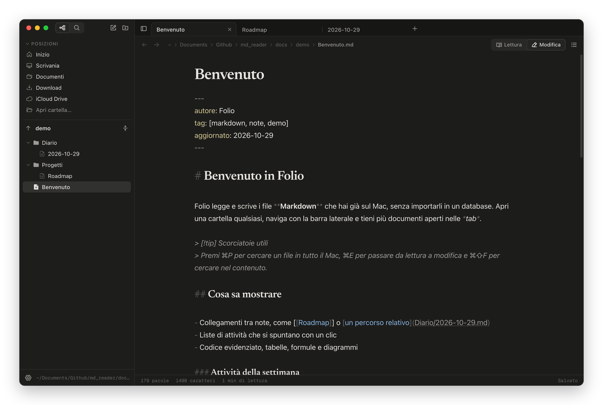

<p align="center">
  
</p>

<h1 align="center">Folio</h1>

<p align="center">
  Lettore ed editor Markdown per macOS, con albero delle cartelle e tab multiple.<br>
  <em>A Markdown reader and editor for macOS with a folder tree and tabs. The interface is in Italian.</em>
</p>



Folio apre i file Markdown che hai già sul Mac, ovunque si trovino. Non c'è un archivio da importare né un database: navighi le cartelle dalla barra laterale, apri più documenti nelle tab, li leggi formattati e li modifichi con salvataggio automatico. L'idea è quella di Obsidian, ridotta a leggere e scrivere file.

## Funzioni

**Navigazione**
- Barra laterale con posizioni rapide (Inizio, Scrivania, Documenti, Download, iCloud Drive), cartelle preferite e la freccia per risalire fino alla radice del disco
- Albero che mostra solo cartelle e file Markdown e si aggiorna quando cambi qualcosa dal Finder
- Rinomina, sposta con il trascinamento, crea note e cartelle, sposta nel Cestino
- Tab riordinabili, cronologia avanti/indietro per ogni tab, sessione ripristinata alla riapertura

**Lettura e scrittura**
- Modalità lettura e modalità modifica (⌘E), con la stessa tipografia e la posizione mantenuta
- Salvataggio automatico; i file modificati da altre app vengono ricaricati
- Indice dei titoli laterale e ricerca nel documento

**Formattazione**
- Codice evidenziato con pulsante di copia, tabelle, note a piè di pagina
- Formule con KaTeX (`$…$` e `$$…$$`) e diagrammi Mermaid
- Liste di attività spuntabili direttamente in lettura
- Callout in stile Obsidian (`> [!tip]`), collegamenti `[[nota]]`, immagini locali
- Front matter YAML mostrato come tabella di proprietà
- Supporto ai pacchetti `.textbundle`

**Ricerca**
- ⌘P cerca per nome tra tutti i file Markdown del Mac tramite Spotlight
- ⌘⇧F cerca nel contenuto dei file della cartella aperta

**Aspetto**
- Tema chiaro, scuro o di sistema; carattere di lettura serif o sans; dimensione e larghezza della pagina regolabili

| Modifica, tema scuro | Apertura rapida |
| --- | --- |
|  |  |

## Installazione

Scarica `Folio-<versione>-arm64.zip` dalla pagina [Releases](https://github.com/cesarebed/folio/releases), estrai e trascina `Folio.app` in Applicazioni.

L'app non è firmata con un certificato Apple Developer, quindi al primo avvio macOS la blocca. Per sbloccarla, da Terminale:

```sh
xattr -dr com.apple.quarantine /Applications/Folio.app
```

La build pubblicata è per Mac con Apple Silicon. Per un Mac Intel compila dai sorgenti.

## Scorciatoie

| Azione | Tasti |
| --- | --- |
| Apertura rapida | ⌘P |
| Nuova nota / nuova tab | ⌘N / ⌘T |
| Lettura ↔ Modifica | ⌘E |
| Cerca nel documento / nei file | ⌘F / ⌘⇧F |
| Chiudi tab / riapri tab chiusa | ⌘W / ⌘⇧T |
| Tab successiva / precedente | ⌃Tab / ⌃⇧Tab |
| Vai alla tab 1–9 | ⌘1 … ⌘9 |
| Indietro / Avanti | ⌘[ / ⌘] |
| Barra laterale / Indice | ⌘\ / ⌘⇧\ |
| Grassetto, corsivo, link (in modifica) | ⌘B, ⌘I, ⌘K |
| Testo più grande / più piccolo | ⌘= / ⌘- |

Con ⌘+clic su un file o su un link lo apri in una nuova tab.

## Sviluppo

Serve Node.js 22 o successivo.

```sh
npm install
npx electron-vite dev   # avvia in sviluppo
npm run typecheck       # controllo dei tipi
npm run dist            # crea release/mac-arm64/Folio.app con firma ad-hoc
```

La cartella `docs/demo` contiene alcune note di esempio da aprire con Folio.

**Struttura**
- `src/main` — processo principale Electron: file system, Spotlight, watcher, menu
- `src/preload` — ponte IPC verso l'interfaccia
- `src/renderer` — interfaccia React: albero, tab, lettore (markdown-it) ed editor (CodeMirror 6)

## Licenza

[MIT](LICENSE)
